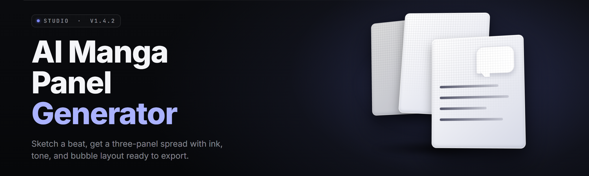

  
  
  

  

  
  

---

**MangaPanelForge AI — AI manga panel generator for Windows (2026)**

*Desktop .exe · no pip · no npm · no git clone*

---

## 🧩 All Modules Status

Every module is verified working before this build shipped. Status table first, features second — that's the order that matters.

| Module | Status | Description |
|---|---|---|
| Script Intake Parser | ✅ Working | Reads `.txt`, `.md`, `.fountain`, `.docx` scripts into panel beats |
| Beat Splitter | ✅ Working | Breaks prose into shot-sized panels with pacing heuristics |
| Panel Layout Engine | ✅ Working | Grid, staggered, cinematic, 4-koma, vertical-scroll presets |
| Camera Angle Classifier | ✅ Working | Assigns wide / medium / close / POV per beat |
| Character Consistency Locker | ✅ Working | Locks face + outfit across panels via seed pinning |
| Bubble Placement AI | ✅ Working | Auto-positions speech bubbles, avoids face occlusion |
| SFX Typography Engine | ✅ Working | Onomatopoeia overlay with manga-style lettering |
| Screentone Generator | ✅ Working | Halftone, crosshatch, gradient dot patterns |
| Line Art Cleaner | ✅ Working | Removes rough sketch noise, snaps strokes |
| Ink Weight Controller | ✅ Working | Per-panel line thickness + taper tuning |
| Speed Line Renderer | ✅ Working | Radial + directional motion lines |
| Focus Blur Compositor | ✅ Working | Depth-of-field across panel layers |
| Background Extender | ✅ Working | Outpaints cropped backgrounds to panel bounds |
| Pose Reference Match | ✅ Working | Suggests poses from script verbs |
| Expression Sheet Mapper | ✅ Working | Emotion tags → face variants |
| Costume Swap Module | ✅ Working | Wardrobe change without re-locking face |
| Panel Border Styler | ✅ Working | Bleed, gutter, torn-edge, ink-bleed frames |
| Page Rhythm Analyzer | ✅ Working | Flags pages with flat pacing |
| Dialogue Formatter | ✅ Working | Wraps, hyphenates, sizes text per bubble |
| Translation Overlay | ✅ Working | Multi-language bubble pass |
| Export — PNG Sheet | ✅ Working | Per-page PNG + per-panel PNG |
| Export — PSD Layered | ✅ Working | Layers grouped by panel + bubble + SFX |
| Export — PDF Proof | ✅ Working | Print-ready proof with bleed marks |
| Export — Webtoon Strip | ✅ Working | Vertical scroll export |
| Style LoRA Loader | ✅ Working | Drop-in style packs |
| Seed Manager | ✅ Working | Save + recall panel seeds |
| Batch Queue | ✅ Working | Queue 50+ pages unattended |
| GPU Memory Governor | ✅ Working | Tunes VRAM use per panel size |
| Upscale Pass | ✅ Working | 2x / 4x panel upscale |
| Watermark Toggle | ✅ Working | Optional creator mark |
| Project Autosave | ✅ Working | Crash-safe project files |
| Hotkey Binder | ✅ Working | Rebind every action |
| CLI Headless Mode | ✅ Working | Script → panels with no GUI |
| Plugin Bridge | ✅ Working | Load community panel packs |

---

## 📋 System Requirements

| Component | Minimum | Recommended |
|---|---|---|
| OS | Windows 10 64-bit (build 1909+) | Windows 11 23H2+ |
| CPU | 4-core / 2.5 GHz | 8-core / 3.6 GHz+ |
| RAM | 8 GB | 32 GB |
| GPU | 6 GB VRAM, DirectX 12 | 12 GB+ VRAM, RTX 30xx/40xx |
| Disk | 12 GB free | 40 GB NVMe SSD |
| Runtime | .NET 6 Desktop Runtime | .NET 8 Desktop Runtime |
| Display | 1366×768 | 1920×1080 or higher |

---

## ❓ FAQ

<strong>Does it need a Python install?</strong>

No. The .exe bundles the runtime. Extract the folder, run the .exe, done.

<strong>Can I keep my character consistent across 40 pages?</strong>

Yes. The Character Consistency Locker pins a seed + reference sheet to a character ID. Every panel referencing that ID inherits the lock.

<strong>What script formats does it read?</strong>

`.txt`, `.md`, `.fountain`, and `.docx`. Fountain is the cleanest input — it maps scene headings and dialogue directly.

<strong>Will it run on a laptop GPU?</strong>

Yes, with the GPU Memory Governor set to "Low VRAM." Panel resolution caps around 1024px per panel on 6 GB cards.

<strong>Can I edit panels in Photoshop after export?</strong>

Export as Layered PSD. Panels, bubbles, SFX, and screentone each land on their own group.

<strong>Does it support webtoon vertical scroll?</strong>

Yes. Webtoon Strip export renders continuous vertical output with gutter spacing tuned for scroll reading.

<strong>Is there a headless mode?</strong>

Yes. `--headless` runs script → panels with no GUI, useful for batch pipelines.

<strong>How do updates work?</strong>

The launcher checks for a newer build on startup. Style packs and plugin packs update independently.

<strong>Can I use my own style?</strong>

Drop a style pack into `/styles`. The Style LoRA Loader picks it up on next launch.

<strong>What about commercial use?</strong>

MIT-licensed tool. Output ownership depends on the style packs you load — check each pack's license.

---

## 📚 Grouped Module Catalog

### ✏️ **Script & Story Intake**

| Feature | Effect |
|---|---|
| Fountain parser | Scene headings become panel groups |
| Beat splitter | Prose → shot-sized panels |
| Pacing heuristics | Flags rushed or dragging pages |
| Dialogue extractor | Separates speech from action lines |

### 🎨 **Panel Composition**

| Feature | Effect |
|---|---|
| Layout presets | Grid, staggered, cinematic, 4-koma |
| Camera classifier | Wide / medium / close / POV per beat |
| Focus blur | Depth cues across layers |
| Border styler | Bleed, gutter, torn-edge frames |

### 🖌️ **Art & Rendering**

| Feature | Effect |
|---|---|
| Screentone generator | Halftone, crosshatch, dot gradients |
| Speed lines | Radial + directional motion |
| Line art cleaner | Removes sketch noise |
| Ink weight controller | Per-panel taper tuning |

### 💬 **Text & Lettering**

| Feature | Effect |
|---|---|
| Bubble placement | Avoids face occlusion |
| SFX typography | Manga-style onomatopoeia |
| Dialogue formatter | Wrap + hyphenate + size |
| Translation overlay | Multi-language pass |

### 📤 **Export & Delivery**

| Feature | Effect |
|---|---|
| PNG sheet | Per-page + per-panel |
| Layered PSD | Grouped: panel, bubble, SFX |
| PDF proof | Print-ready with bleed |
| Webtoon strip | Vertical scroll output |

### ⚙️ **Automation & Pipeline**

| Feature | Effect |
|---|---|
| Batch queue | 50+ pages unattended |
| CLI headless | Script → panels, no GUI |
| Plugin bridge | Community panel packs |
| Autosave | Crash-safe project files |

---

## ⚖️ Comparison

| Aspect | Alternative | This Tool |
|---|---|---|
| Install | pip / npm / manual env | Extract .exe, run |
| Script input | Copy-paste per panel | Full script file parsing |
| Character lock | Manual re-prompt | Seed + reference pinning |
| Bubble layout | Manual drag | Auto-place with occlusion check |
| Export | Screenshot per panel | Layered PSD + PDF + webtoon |
| Batch | One page at a time | 50+ page queue |
| Headless | Not supported | `--headless` CLI mode |
| Style packs | Re-train from scratch | Drop-in LoRA loader |

---

## 💡 Tips for Best Results

- Write scripts in Fountain — cleanest beat extraction.
- Lock character seeds before generating page 1, not after.
- Set GPU Governor to "Low VRAM" on 6 GB cards.
- Use the Pacing Analyzer after every 10-page batch.
- Keep style packs under 200 MB for fast load.
- Export Layered PSD if you plan post-editing.
- Bind a hotkey to "Re-roll Panel" for fast iteration.
- Run the Focus Blur compositor last — it depends on final layout.

---

## 🛠️ The Solution

| Problem | Solution |
|---|---|
| Manual panel layout is slow | Panel Layout Engine with presets |
| Characters drift across pages | Character Consistency Locker |
| Bubbles cover faces | Occlusion-aware placement |
| Script → panels is tedious | Beat Splitter + Camera Classifier |
| Export is one-by-one | Batch + multi-format export |
| No webtoon output | Webtoon Strip exporter |
| Style changes need re-training | Drop-in Style LoRA Loader |

---

## 🏁 Quick Start

1. 📄 Grab the build from the project page.
2. 📦 Extract the archive to a folder you own.
3. 🖱️ Right-click the `.exe` → **Run as Administrator** (first launch only).
4. 🎬 Launch — the intake wizard opens.
5. ⌨️ Load a script, hit **Generate**, and bind a hotkey for re-roll.

---

## 📖 What is AI manga panel generator?

| Term | Explanation |
|---|---|
| Panel | A single framed shot in a manga page |
| Beat | One story moment mapped to one panel |
| Screentone | Dot/halftone shading used in manga |
| Bubble | Speech or thought container |
| SFX | Onomatopoeia drawn into the art |
| Seed | A pinned value that reproduces art |
| LoRA | A small style pack layered onto the model |
| Webtoon | Vertical-scroll comic format |

**Why it matters:**

- Turns a script file into a full panel draft in minutes.
- Keeps characters consistent without manual re-prompting.
- Exports in the formats publishers and webtoon platforms accept.
- Runs fully offline on Windows — no cloud round-trips.
- Batch mode scales from a single page to a full chapter.
- Style packs let you swap visual identity without retraining.

---

## 🖥️ Compatibility / Platform Support

| Platform | Support |
|---|---|
| Windows 10 64-bit | ✅ Full |
| Windows 11 | ✅ Full |
| Windows on ARM | ⚠️ Emulated only |
| Linux | ❌ Not supported |
| macOS | ❌ Not supported |
| Web browser | ❌ Not supported |

---

## 🐛 Known Issues

| Issue | Solution |
|---|---|
| First launch slow on cold disk | Let it finish — caches build once |
| Bubbles overlap on 4-koma | Reduce bubble font size in settings |
| PSD export large | Disable screentone layer merge |
| Low VRAM stalls | Set GPU Governor to Low VRAM |
| Fountain parse errors | Check scene headings use `INT./EXT.` |
| Hotkeys ignored | Run as Administrator |

---

## 🎯 Overview

| Category | Details |
|---|---|
| Product | MangaPanelForge AI |
| Type | Windows desktop .exe |
| Input | Script files (txt/md/fountain/docx) |
| Output | PNG, PSD, PDF, webtoon strip |
| Install | Extract + run |
| Runtime | Bundled — none needed |
| Mode | Offline, GPU-accelerated |

MangaPanelForge AI is a Windows desktop tool that takes a written script and produces a full manga panel draft — layouts, characters, bubbles, screentone, and SFX — exportable in the formats print and webtoon pipelines accept. It runs entirely offline on your machine, ships as a single `.exe`, and needs no Python, Node, or git.

  

---

## 📥 Installation

1. **Download** the release archive from the project page.
2. **Extract** the folder anywhere you own — avoid `Program Files` for the first run.
3. **Run the `.exe` as Administrator** once so it can register hotkeys and caches.
4. **Load a script** in the intake wizard and press **Generate**.

---

## 🧭 Table of Contents

- [All Modules Status](#-all-modules-status)
- [System Requirements](#-system-requirements)
- [FAQ](#-faq)
- [Grouped Module Catalog](#-grouped-module-catalog)
- [Comparison](#️-comparison)
- [Tips for Best Results](#-tips-for-best-results)
- [The Solution](#️-the-solution)
- [Quick Start](#-quick-start)
- [What is AI manga panel generator?](#-what-is-ai-manga-panel-generator)
- [Compatibility / Platform Support](#️-compatibility--platform-support)
- [Known Issues](#-known-issues)
- [Overview](#-overview)
- [Installation](#-installation)

---

MangaPanelForge AI is built for creators who'd rather ship a chapter than fight a pipeline. Extract it, point it at a script, and the first draft lands before your coffee cools. Everything after that is editing — the part humans are still better at.

  

